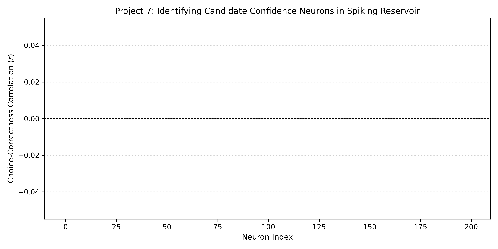

# Candidate Confidence Neurons (`lsm-07-candidate-confidence-neurons`)

[](https://opensource.org/licenses/MIT)
[](https://www.python.org/)
[](https://brian2.readthedocs.io/)

> *Isolating neuronal-level metacognitive signatures: identifying individual Leaky Integrate-and-Fire units whose pre-decision firing dynamics predict trial-by-trial choice correctness in a Liquid State Machine.*

---

## Abstract & Scientific Rationale



In biological neural circuits and advanced recurrent neuromorphic architectures, decision uncertainty is often distributed across population trajectories. However, specific subpopulations often exhibit enhanced sensitivity to decision confidence. 

This project implements an exploratory framework within **Brian2** to scan a 200-neuron Leaky Integrate-and-Fire (LIF) reservoir, correlating individual unit firing rates against trial-by-trial decoder accuracy. Neurons exhibiting high absolute point-biserial correlation with downstream choice correctness are isolated as **candidate confidence neurons**, serving as an internal metric of epistemic uncertainty.

---

## Mathematical Formulation

For each trial $t$ with stimulus stream $u_t$, the reservoir state vector $\mathbf{x}(t)$ evolves according to LIF membrane dynamics:

$$\tau \frac{dv_i}{dt} = -(v_i - v_{\text{rest}}) + I_{\text{syn}}^{(i)} + I_{\text{ext}}^{(i)}$$

The choice-correctness score $C_i$ for neuron $i$ is quantified via the correlation between its trial-averaged firing rate $r_i^{(t)}$ and the binary trial correctness indicator $I_{\text{correct}}^{(t)}$:

$$C_i = \text{corr}\left( r_i^{(t)}, \, \mathbb{I}(\hat{y}^{(t)} = y^{(t)}) \right)$$

Units located in the extreme tails of the distribution $C_i$ are classified as candidate confidence encoders.

---

## Repository Architecture

```text
lsm-07-candidate-confidence-neurons/
├── data/
│   └── README.md
├── figures/
│   └── main_result.png
├── src/
│   ├── __init__.py
│   ├── data.py
│   ├── reservoir.py
│   └── analysis.py
├── scripts/
│   └── run_experiment.py
├── .gitignore
├── requirements.txt
└── README.md